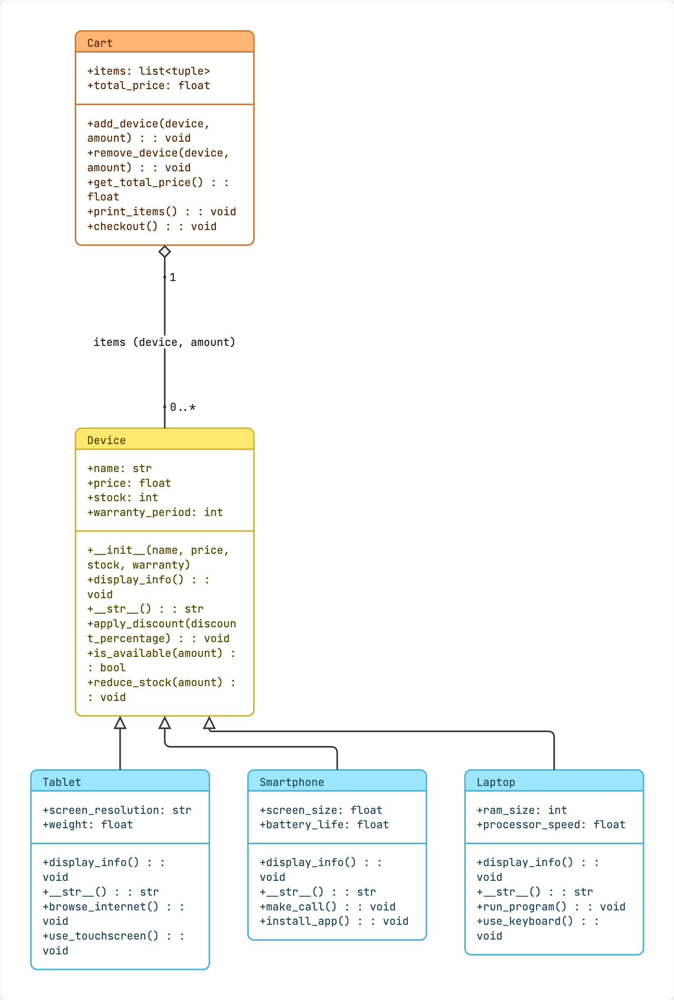

# Electronic Device Shopping Cart

## 1. Project Description

This project is a Python-based Electronic Device Shopping Cart application developed using Object-Oriented Programming (OOP).

The application allows users to browse electronic devices, add products to a shopping cart, view cart contents, and complete purchases.

The application includes three types of electronic devices:
- Smartphones
- Laptops
- Tablets

Users can:
- View available devices and their characteristics.
- Select a device and specify the desired quantity.
- Add devices to the shopping cart.
- View cart items, quantities, and total price.
- Complete checkout.
- Check product availability before purchasing.
- Update device stock after a successful checkout.

## 2. Project Structure

The repository contains the following files:

```text
electronic-device-shopping-cart/
│
├── main.py
├── test_main.py
├── README.md
└── ed-shopping-cart-uml.jpg
```

- **main.py** – Contains the Device, Smartphone, Laptop, Tablet, and Cart classes.
- **test_main.py** – Creates sample devices, initializes the shopping cart, and runs the menu-driven application.
- **README.md** – Project documentation, UML diagram, and sample application runs.
- **ed-shopping-cart-uml.jpg** – UML class diagram illustrating the structure and relationships between the classes.

## 3. UML Class Diagram

The following UML class diagram illustrates the classes, attributes, methods, inheritance relationships, and association between the Cart and Device classes.



## 4. Classes and Methods

### 4.1 Device

The `Device` class is the parent class of all electronic devices. It contains the common attributes and methods shared by smartphones, laptops, and tablets.

**Attributes:**
- `name` – The name of the device (string).
- `price` – The price of the device (float).
- `stock` – The available quantity (integer).
- `warranty` – The warranty period (integer).

**Methods:**
- `__init__(name, price, stock, warranty)` – Initializes a device and its attributes.
- `display_info()` – Displays device information.
- `__str__()` – Returns a formatted string representation of the device.
- `apply_discount(discount_percentage)` – Calculates and displays the discounted price.
- `is_available(amount)` – Checks whether the requested quantity is available.
- `reduce_stock(amount)` – Reduces the device stock if sufficient stock is available.

### 4.2 Smartphone

The `Smartphone` class inherits from `Device` and adds smartphone-specific attributes and methods.

**Additional attributes:**
- `screen_size` – The screen size in inches.
- `battery_life` – The battery life in hours.

**Methods:**
- `display_info()` – Displays general device information and smartphone characteristics.
- `__str__()` – Returns a formatted string representation.
- `make_call()` – Represents the smartphone's calling functionality.
- `install_app()` – Represents the ability to install applications.

### 4.3 Laptop

The `Laptop` class inherits from `Device` and adds laptop-specific attributes and methods.

**Additional attributes:**
- `ram_size` – The amount of RAM in GB.
- `processor_speed` – The processor speed in GHz.

**Methods:**
- `display_info()` – Displays general device information and laptop characteristics.
- `__str__()` – Returns a formatted string representation.
- `run_program()` – Represents the ability to run programs.
- `use_keyboard()` – Represents keyboard functionality.

### 4.4 Tablet

The `Tablet` class inherits from `Device` and adds tablet-specific attributes and methods.

**Additional attributes:**
- `screen_resolution` – The screen resolution (e.g., 2048x1536).
- `weight` – The weight of the tablet in grams.

**Methods:**
- `display_info()` – Displays general device information and tablet characteristics.
- `__str__()` – Returns a formatted string representation.
- `browse_internet()` – Represents the ability to browse the internet.
- `use_touchscreen()` – Represents touchscreen functionality.

### 4.5 Cart

The `Cart` class manages the shopping cart and its contents.

**Attributes:**
- `items` – A list containing device and quantity tuples.
- `total_price` – The total price of the items in the cart.

**Methods:**
- `add_device(device, amount)` – Adds a device to the cart if sufficient stock is available.
- `remove_device(device, amount)` – Removes the specified device and quantity from the cart.
- `get_total_price()` – Returns the total price of the cart.
- `print_items()` – Displays the devices and quantities in the cart.
- `checkout()` – Checks whether all requested quantities are available, reduces stock, displays the purchase information, and clears the cart after a successful checkout.

## 5. How to Run the Application

### Requirements

- Python 3 installed.
- No external libraries are required.

### Running the application

1. Clone or download this repository.
2. Open the project folder in a terminal or code editor.
3. Run the following command:

```bash
python test_main.py
```

4. The application menu will appear.

### Application Menu

The menu provides the following options:

1. Show Devices – Displays all available smartphones, laptops, and tablets with their details and allows the user to select a device.
2. Show Cart – Displays the current shopping cart contents and total price.
3. Exit Program – Closes the application.
4. Checkout – Checks product availability and completes the purchase if all items are available.

## 6. Sample Input and Output

The following examples demonstrate the main functionality of the application.

### Example 1: Displaying all devices

**Input:**

```text
Choose an option: 1
```

**Output:**

```text
1 Smartphone
Name: iPhone 13
Price: 700
Stock: 10
Warranty period: 24 months
Screen size: 6.1 inches
Battery: 20 hours
2 Laptop
Name: Macbook Pro
Price: 3600
Stock: 8
Warranty period: 24 months
RAM: 8 GB
Processor speed: 4.8 GHz
3 Tablet
Name: Samsung
Price: 1200
Stock: 11
Warranty period: 24 months
Screen resolution: 14.6
Weight: 700 grams
4 Smartphone
Name: Samsung Galaxy S24
Price: 850
Stock: 12
Warranty period: 24 months
Screen size: 6.2 inches
Battery: 22 hours
5 Laptop
Name: Dell XPS 15
Price: 2200
Stock: 6
Warranty period: 24 months
RAM: 16 GB
Processor speed: 5.0 GHz
6 Tablet
Name: iPad Air
Price: 950
Stock: 9
Warranty period: 24 months
Screen resolution: 2360x1640
Weight: 460 grams
7 Smartphone
Name: iPhone 15
Price: 900
Stock: 15
Warranty period: 24 months
Screen size: 6.1 inches
Battery: 20 hours
8 Smartphone
Name: Google Pixel 8
Price: 750
Stock: 10
Warranty period: 24 months
Screen size: 6.2 inches
Battery: 24 hours
9 Smartphone
Name: OnePlus 12
Price: 800
Stock: 7
Warranty period: 24 months
Screen size: 6.8 inches
Battery: 18 hours
10 Smartphone
Name: Xiaomi 14
Price: 680
Stock: 13
Warranty period: 24 months
Screen size: 6.36 inches
Battery: 21 hours
11 Laptop
Name: HP Pavilion
Price: 1100
Stock: 9
Warranty period: 24 months
RAM: 16 GB
Processor speed: 4.2 GHz
12 Laptop
Name: Lenovo ThinkPad
Price: 1500
Stock: 5
Warranty period: 24 months
RAM: 32 GB
Processor speed: 4.5 GHz
13 Laptop
Name: Asus ZenBook
Price: 1300
Stock: 8
Warranty period: 24 months
RAM: 16 GB
Processor speed: 4.7 GHz
14 Laptop
Name: Acer Aspire
Price: 850
Stock: 12
Warranty period: 24 months
RAM: 8 GB
Processor speed: 3.8 GHz
15 Laptop
Name: MSI Gaming Laptop
Price: 2400
Stock: 4
Warranty period: 24 months
RAM: 32 GB
Processor speed: 5.2 GHz
16 Tablet
Name: Samsung Galaxy Tab S9
Price: 900
Stock: 8
Warranty period: 24 months
Screen resolution: 2560x1600
Weight: 500 grams
17 Tablet
Name: iPad Pro
Price: 1400
Stock: 6
Warranty period: 24 months
Screen resolution: 2732x2048
Weight: 466 grams
18 Tablet
Name: Lenovo Tab P12
Price: 550
Stock: 10
Warranty period: 24 months
Screen resolution: 2944x1840
Weight: 615 grams
19 Tablet
Name: Microsoft Surface Go
Price: 700
Stock: 7
Warranty period: 24 months
Screen resolution: 1920x1280
Weight: 544 grams
20 Tablet
Name: Xiaomi Pad 6
Price: 450
Stock: 14
Warranty period: 24 months
Screen resolution: 2880x1800
Weight: 490 grams
```

### Example 2: Adding a device to the cart

**Input:**

```text
Choose an option: 1
Choose a device: 1
How many? 2
```

The selected device is added to the cart if sufficient stock is available.

### Example 3: Viewing the shopping cart

**Input:**

```text
Choose an option: 2
```

**Output:**

```text
Name: iPhone 13 Quantity: 2 Price: 700
Total price: 1400.00
1. Show Devices
2. Show cart
3. Exit program
4. Checkout
Choose an option:
```

### Example 4: Successful checkout

**Input:**

```text
Choose an option: 4
```

**Output:**

```text
Available
Name: iPhone 13 Quantity: 2 Price: 700
Checkout successful!
```

After a successful checkout, the stock quantity is reduced and the shopping cart is cleared.

### Example 5: Exiting the application

**Input:**

```text
Choose an option: 3
```

**Output:**

```text
Exiting program...
```

## 7. Author

Sassysmurf